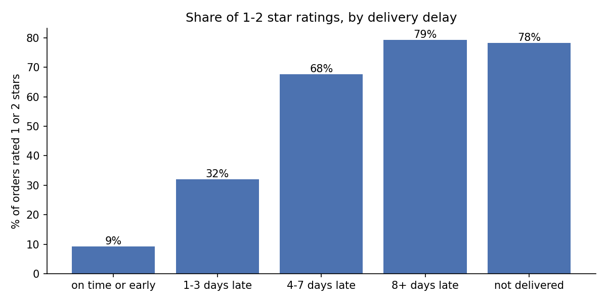
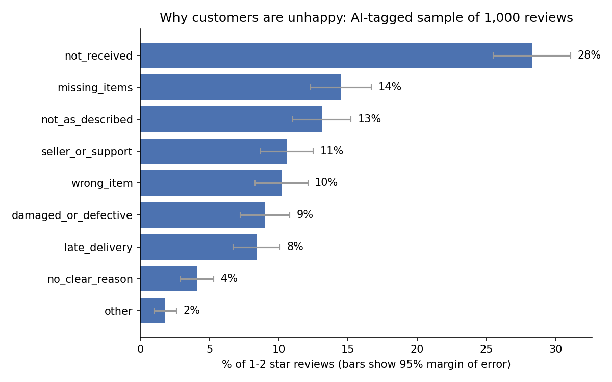

# AI complaint triage: what really drives 1- and 2-star reviews?

An LLM read 1,000 unhappy customer reviews from a real Brazilian marketplace and tagged each one with the reason the customer was unhappy. I checked its labels against the operational data and against my own blind labels, then sized each reason to decide what operations should fix first.

**Headline:** late and undelivered orders are only 9% of orders but drive about 43% of 1- and 2-star reviews. The other 57% come from orders that arrived on time, and the star rating alone can't tell you why. The AI shows that most of those are fulfilment and product problems: missing or wrong items, and products that don't match the listing. Tagging cost **$0.08 per 1,000 reviews** and took under 4 minutes, against roughly 8 hours of manual work.

## Business question

A marketplace receives thousands of negative reviews in free text, in this case in Portuguese. Teams usually see only the star rating, not the reason behind it. Can an LLM tag every complaint with a reason code accurately and cheaply enough for operations to use it when deciding what to fix?

## Data

[Brazilian E-Commerce Public Dataset by Olist](https://www.kaggle.com/datasets/olistbr/brazilian-ecommerce): about 100,000 real, anonymised orders from 2016 to 2018, with order, delivery, item, product and review tables. Licensed CC BY-NC-SA 4.0. Thanks to Olist for releasing it.

- 98,095 orders with a review after deduplication (some orders had two reviews; I kept the latest).
- 14,350 reviews (14.7%) gave 1 or 2 stars, and 10,711 of those (75%) included a written comment. Those 10,711 are the pool the AI samples from.

## Approach

1. **Baseline in SQL** (DuckDB): how ratings change with delivery delay.
2. **Random sample** of 1,000 negative reviews with comments (seed 42), which gives a margin of error of about ±2 to 3 points on each reason's share.
3. **LLM classifier** (Gemini 3.1 Flash-Lite, free tier). The model gets a fixed list of 9 reason codes with written definitions, tie-break rules and Portuguese examples ([prompt.txt](prompt.txt)), and returns structured JSON at temperature 0, with 25 reviews per API call.
4. **Two independent accuracy checks**: the operational delivery data, and my own blind labels on 100 reviews.
5. **Sizing**: share of complaints, order value behind each reason, and cost compared with manual tagging.

## How I checked the AI

**Check 1: does it agree with the delivery data?** The model only read the review text. The orders table separately records whether each order arrived late or never arrived. If the labels are right, the two should line up, and they do:

| AI's label | Reviews | Order actually late or never delivered |
|---|---:|---:|
| not_received | 283 | 81% |
| late_delivery | 84 | 64% |
| wrong_item | 102 | 4% |
| not_as_described | 131 | 4% |
| missing_items | 145 | 3% |
| damaged_or_defective | 90 | 1% |

Reviews tagged as delivery problems are 16 to 74 times more likely to be on late or undelivered orders than reviews tagged as product or fulfilment problems. `late_delivery` sits at 64% rather than near 100% because some customers complain about slowness even when the order arrives inside a long promised window.

**Check 2: does it agree with a human?** I labelled 100 random reviews myself without seeing the AI's answers, reading them through Google Translate so that Gemini's view could not influence mine.

**Result: 78% agreement, Cohen's kappa 0.74** (substantial agreement; kappa corrects for agreement by chance). I then went through all 22 disagreements against the written code definitions:

| What caused the disagreement | Cases | Example |
|---|---:|---|
| **I** didn't apply the codebook; the AI did | 13 | I tagged invoice mismatches and thin towels as `other`, but the definitions put them under `seller_or_support` and `not_as_described` |
| A real gap in the definitions | 5 | `wrong_item` vs `not_as_described` blur when the colour differs from the photo; no rule for "late **and** broken" |
| Genuinely ambiguous | 4 | "The store shipped the rug from China" |

So the model was more consistent with the codebook than I was on a first pass. That's the same lesson as training a human CX team: the labels are only as good as the definitions and how strictly people stick to them. The 5 definition gaps are the next prompt fix (see Next steps).

## Key findings

**1. Delay hurts ratings in a sharp step, not a gradual slope.**

| Delivery | Share of orders | Rated 1 or 2 stars |
|---|---:|---:|
| On time or early | 90.7% | 9% |
| 1 to 3 days late | 1.9% | 32% |
| 4 to 7 days late | 1.8% | 68% |
| 8+ days late | 2.8% | 79% |
| Not delivered | 2.8% | 78% |

Customers mostly tolerate a short delay. Past 3 days late, the share of unhappy customers doubles. Late and undelivered orders together are 9.3% of orders but produce about 43% of all 1- and 2-star reviews.

**2. The AI reveals what the star rating hides.**

| Group | Reasons | Share of negative reviews |
|---|---|---:|
| Delivery | not received 28%, late 8% | 37% |
| Fulfilment accuracy | missing items 15%, wrong item 10% | 25% |
| Product quality | not as described 13%, damaged or defective 9% | 22% |
| Seller service | cancellations, refunds, no reply | 11% |
| Unclear or other | | 6% |

Nearly half of negative reviews (47%) are about the order's contents, not its delivery: the wrong item, a missing item, or a product that doesn't match the listing. A delivery-only view of customer experience misses all of these.

**3. Many "not received" complaints are really "late, and still waiting".** Only 29% of orders tagged `not_received` were never delivered. Another 52% arrived, but late. The customer wrote the review while still waiting, probably because the review request goes out around the estimated delivery date. So the real delivery problem is larger than the `late_delivery` label alone suggests.

**4. Missing items: about a fifth come from split shipments, the rest from seller packing.** `missing_items` orders have the highest average value of any reason (R$249). When an order includes items from more than one seller, they ship in separate parcels:

| Order type | Negative reviews | About missing items |
|---|---:|---:|
| Single-seller order | 961 | 12% |
| Multi-seller order | 39 | 72% |

Multi-seller orders are only 4% of negative reviews but about 19% of missing-item complaints (28 of 145). The group is small (margin about ±14 points), but the gap is far bigger than the noise. The likely cause: the first parcel arrives, and the customer thinks the rest is lost. The other 81% of missing-item complaints are on single-seller orders, which points to packing errors at the seller.

**5. Product problems are spread across categories, so prioritise by volume, not rate.** Damaged, defective and not-as-described complaints, by the main category of the order:

| Category | Negative reviews | Product problems | Rate |
|---|---:|---:|---:|
| computers_accessories | 79 | 26 | 33% |
| bed_bath_table | 110 | 25 | 23% |
| furniture_decor | 70 | 19 | 27% |
| watches_gifts | 57 | 16 | 28% |
| cool_stuff | 39 | 13 | 33% |
| health_beauty | 63 | 11 | 18% |
| auto | 32 | 11 | 34% |
| telephony | 44 | 11 | 25% |

The rates range from 18% to 34%, but with only 30 to 110 reviews per category the margins are ±8 to 16 points, so most of those differences are noise. Volume is the more useful signal. Three categories account for about a third of all product complaints (70 of 221): computer accessories, bed/bath (thin towels came up repeatedly) and furniture. I reached the same conclusion about return rates in my [e-commerce funnel project](https://github.com/ninadvichare/ecommerce-funnel-analysis).

Extrapolated to the full pool, the orders behind these complaints are worth about R$2.0M. That's the order value exposed to unhappy customers, not lost revenue.

## Recommendations

1. **Target the 4-day cliff, not average delivery time.** Flag orders at risk of running 4 or more days late, and act on those first: re-route, upgrade the shipping, or proactively notify the customer before they write the review.
2. **Send the review request after confirmed delivery**, not on the estimated date. That stops "still waiting" reviews from landing before the parcel does, and makes ratings measure the product and service rather than the timing of an email.
3. **Tell customers when an order ships in more than one parcel.** On multi-seller orders, show "arrives in 2 parcels" at checkout and in the order tracking, with a tracking link for each parcel. This is a cheap fix for complaints that are 72% "missing items" on those orders.
4. **Track fulfilment accuracy per seller.** Missing and wrong items are 25% of all complaints, and most missing-item cases are single-seller orders. Score sellers on both, and add a pick-and-pack check for repeat offenders.
5. **Raise listing standards where product complaints are most frequent.** Start with computer accessories, bed/bath and furniture, which account for a third of product complaints. For example, require measurements and fabric weight on towel and bedding listings, since "thinner than expected" came up repeatedly.
6. **Run the classifier on every negative review, every week.** At $0.08 per 1,000 reviews, tagging the whole pool of 10,711 costs under $1 and takes about 40 minutes, against roughly 89 agent-hours by hand. That turns free text into a live complaint dashboard.

## Cost vs manual tagging

| | AI (this run) | Manual |
|---|---:|---:|
| Reviews tagged | 1,000 | 1,000 |
| Time | 3.7 minutes | ~8.3 hours* |
| Cost | $0.084 at paid list price ($0 on free tier) | agent time |
| API calls / tokens | 40 calls, 51K in / 48K out | n/a |

*Assumes 30 seconds per review for a CX agent to read and tag.

## Limitations

- Data is from 2016 to 2018 and covers one Brazilian marketplace.
- The model picks a single primary reason. Some reviews have two (for example, late *and* damaged).
- "Late" is measured against the promised date, not the customer's expectation.
- 25% of negative reviews have no comment, so the AI cannot tag them. The shares describe customers who wrote something.
- Shares come from a 1,000-review sample, so treat gaps smaller than the margin of error as noise.
- My own labels came from reading Google Translate output, which occasionally changed the meaning (for example, "the product I ordered was not delivered" really meant a different product arrived).
- The human check is one labeller on 100 reviews. A second human labeller would give a human-vs-human baseline to compare the AI against.

## Next steps

- **Prompt v2:** split `wrong_item` (a different product or variant arrived) from `not_as_described` (the right product, but it differs from the listing), and add a rule for reviews that mention both a delay and a product problem.
- Allow a secondary reason, so "late and broken" counts towards both.
- Re-test on a fresh blind sample of 100 reviews, rather than reusing the 100 I've already seen.

## Files

| File | What it is |
|---|---|
| `ai_complaint_triage.ipynb` | Full analysis, with outputs |
| `prompt.txt` | The classification prompt |
| `ai_labels.csv` | AI labels for the 1,000 sampled reviews |
| `human_labels.csv` | My blind labels for 100 reviews |
| `rating_by_delivery_delay.png`, `complaint_reasons.png` | Charts |

Built with Claude as a coding assistant. The labelling, analysis and recommendations are my own.
